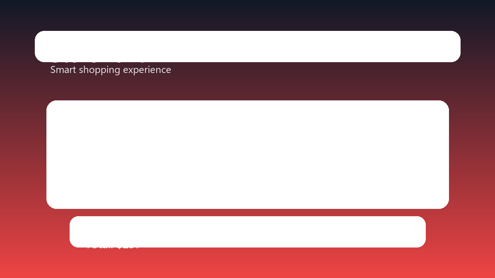
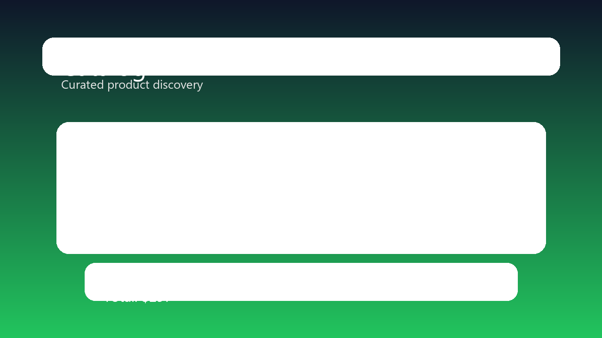
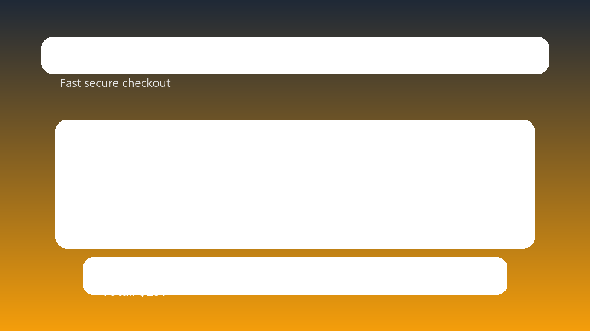

# E-Commerce Chatbot

A full-stack ecommerce chatbot monorepo with a secure Express + MongoDB backend and a React + Vite storefront interface.

## Overview

This project combines:
- a customer-facing storefront with product browsing, cart, checkout, and order tracking
- an AI-powered shopping assistant for product discovery and recommendations
- an admin dashboard for managing products, orders, and store data
- a production-hardened backend with JWT auth, role checks, validation, and health monitoring

## Architecture

- `backend/` — REST API and business logic
- `frontend/` — React application for the storefront and admin panel
- `docs/` — product documentation, screenshots, and supporting assets

## Tech Stack

Backend
- Node.js
- Express
- MongoDB + Mongoose
- JWT authentication
- Helmet, rate limiting, CORS, and env-based configuration

Frontend
- React + TypeScript
- Vite
- React Router
- Tailwind CSS
- React Hot Toast

## Screenshots





## Quick Start

1. Install dependencies at the root:
   ```bash
   npm install
   npm --prefix backend install
   npm --prefix frontend install
   ```
2. Copy environment examples and update values as needed:
   ```bash
   cp backend/.env.example backend/.env
   cp frontend/.env.example frontend/.env
   ```
3. Start both apps together:
   ```bash
   npm run dev
   ```
4. Open the frontend at `http://localhost:5173` and the API at `http://localhost:5000`.

## Scripts

Root scripts:
- `npm run install:all` — install backend and frontend dependencies
- `npm run dev` — run backend and frontend concurrently
- `npm run build` — build the frontend production bundle

Backend scripts:
- `npm --prefix backend run dev`
- `npm --prefix backend run test`
- `npm --prefix backend run lint`
- `npm --prefix backend run seed`
- `npm --prefix backend run init-chatbot`

## Security and Configuration

- JWT secret is required to start the backend.
- Admin password is required in production.
- CORS is restricted via `CLIENT_URL`.
- Sensitive fields are validated and server-side totals are recalculated before orders are created.

## Demo Flow

1. Open the app and create a new customer account or use the demo user account to sign in.
2. Browse products, filter by category/brand/price, and add items to the cart.
3. Complete the checkout flow with shipping details and confirm the order.
4. Sign in with the admin account to manage products, view orders, and update order status.
5. Use the chatbot to ask for recommendations such as: "gợi ý điện thoại dưới 800 đô".
6. Verify the full shopping journey from registration to payment confirmation and admin monitoring.

Demo customer account:
- Email: `customer@example.com`
- Password: `Customer@123`

Demo admin account:
- Email: `admin@example.com`
- Password: `Admin@12345`

## Project Status

This repository is set up as a working monorepo for local development and CI validation.
