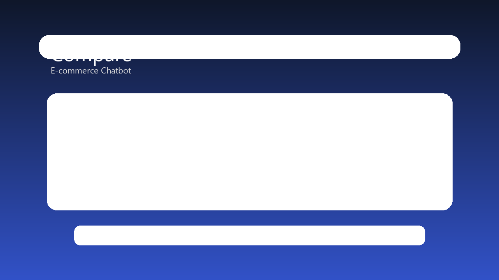
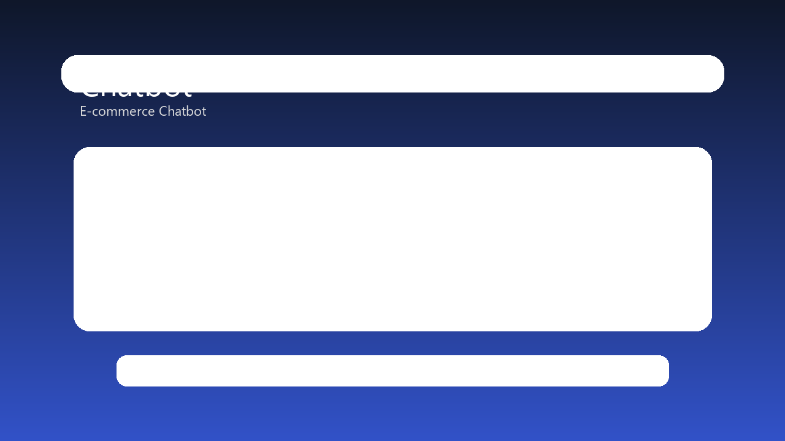

# E-commerce Chatbot — Frontend

Single-page storefront for an electronics shop, with a floating shopping assistant, a checkout flow and an admin area.

> Part of the [E-commerce Chatbot](../README.md) monorepo. The API lives in [`../backend`](../backend/README.md).

## Screenshots

<!-- Add 3–4 images to docs/screenshots and reference them here -->
| Home | Product comparison | Chatbot | Admin |
|---|---|---|---|
|  |  |  |  |

## Features

**Shopping**
- Product listing with search and live suggestions, category pages, product detail
- Side-by-side product comparison
- Cart (persisted per user) and multi-step checkout with order confirmation
- Order history and order detail pages
- User profile

**Chatbot**
- Floating chat widget available on every page, talking to `POST /api/chatbot/message`

**Admin**
- Role-protected routes (`/admin/*`)
- Product list, add and edit
- Order list and order detail with status updates
- Sales statistics charts

## Tech stack

React 18 · TypeScript · Vite 5 · Tailwind CSS · React Router 6 · Axios · Recharts · Lucide icons · react-hot-toast · jwt-decode

## Getting started

**Requirements:** Node.js 18+ and the backend running (see [backend README](../backend/README.md)).

```bash
cd frontend
npm install
cp .env.example .env     # set VITE_API_URL if the API is not on localhost:5000
npm run dev              # http://localhost:5173
```

In development, Vite proxies `/api` to `http://localhost:5000`, so no extra configuration is needed locally.

### Scripts

| Command | Description |
|---|---|
| `npm run dev` | Start the dev server |
| `npm run build` | Type-check and build to `dist/` |
| `npm run preview` | Serve the production build locally |
| `npm run lint` | Run ESLint |

### Environment variables

| Variable | Description | Default |
|---|---|---|
| `VITE_API_URL` | Base URL of the backend API, e.g. `https://api.example.com/api` | `/api` (proxied in dev) |

## Project structure

```
frontend/src/
├── components/     # UI: Admin, Auth, Cart, Checkout, Chatbot, Orders, ProductComparison, ...
├── pages/          # route-level pages
├── hooks/          # useAuth, useCart, CartProvider
├── services/       # API clients (products, auth, cart, orders, admin, users)
├── types/          # shared TypeScript types
└── utils/          # formatting helpers
```

## Authentication

The JWT returned by `POST /api/auth/login` is stored client-side and sent as `Authorization: Bearer <token>`. `PrivateRoute` guards signed-in pages and `AdminRoute` additionally requires `role === "admin"`; the API enforces the same rules server-side.

## Roadmap

- [ ] Component and E2E tests (Vitest, Playwright)
- [ ] Online payment integration (sandbox)
- [ ] Order status notifications

## License

MIT
